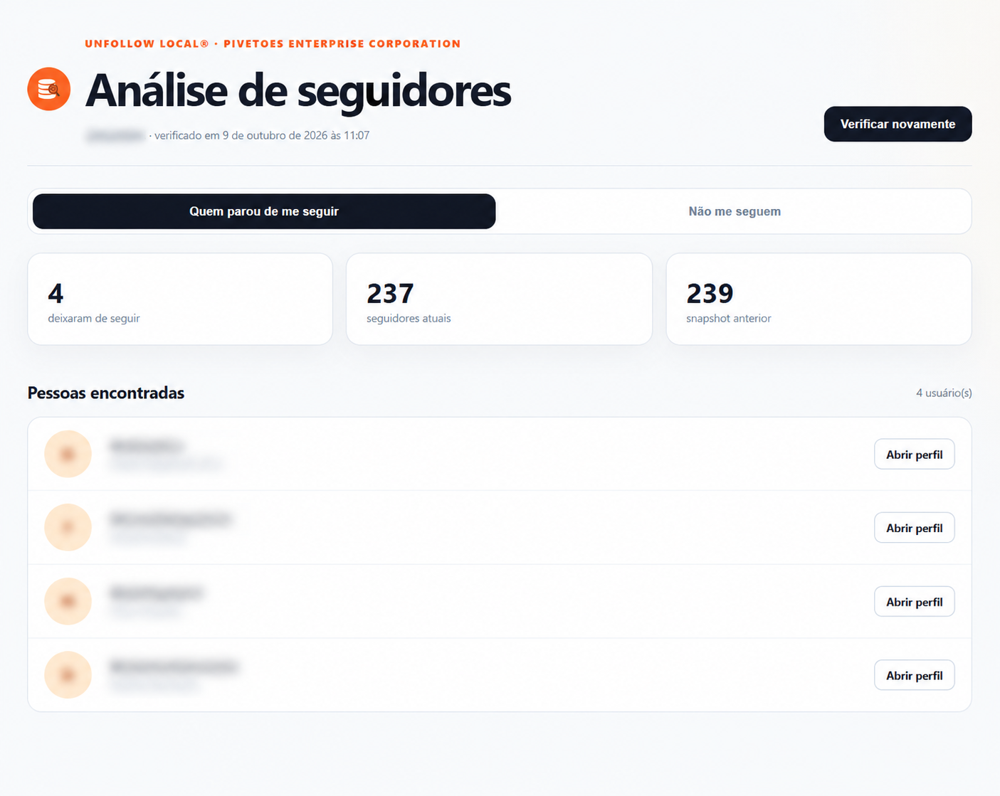
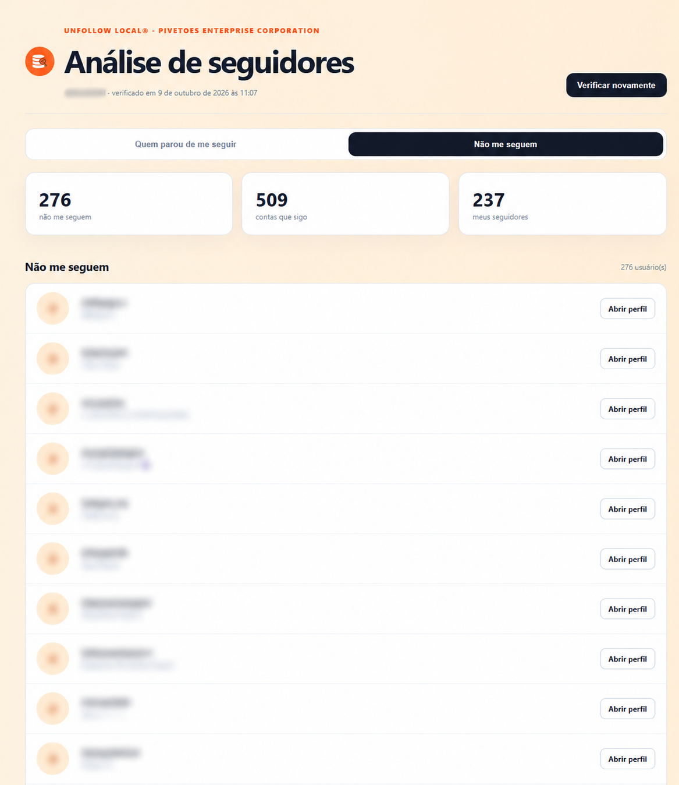

# Unfollow Local para Instagram

Extensão local para Microsoft Edge e Google Chrome que mantém duas análises separadas:

- **Quem parou de me seguir:** compara o snapshot atual de seguidores com o anterior.
- **Não me seguem:** calcula, no estado atual, `seguindo - seguidores`.

**Categoria:** Extensão de navegador · Comparação de seguidores.

## Tecnologias principais

- JavaScript
- Chrome Extension Manifest V3
- APIs de armazenamento do navegador

A comparação é feita por diferenças entre conjuntos e snapshots. Este projeto não utiliza modelos de IA ou aprendizado de máquina. O dashboard, o popup e a coleta fazem parte desta mesma extensão, sem backend separado.

## Versão

`1.2.1` — dois fluxos independentes, progresso por lista e tolerância segura para pequenas divergências do contador de contas seguidas.

## Como instalar

1. Extraia o ZIP.
2. Abra `edge://extensions` ou `chrome://extensions`.
3. Ative **Modo de desenvolvedor**.
4. Clique em **Carregar sem compactação**.
5. Selecione a pasta extraída que contém o `manifest.json`.
6. Fixe a extensão na barra do navegador.

Ao atualizar uma instalação anterior, remova a versão carregada sem compactação e carregue novamente esta pasta.

## Como usar

1. Clique no ícone da extensão.
2. Escolha **Quem parou de me seguir** ou **Quem não me segue de volta**.
3. Faça login diretamente no Instagram, se necessário.
4. Mantenha a aba aberta durante a paginação.
5. O dashboard abrirá diretamente na análise escolhida.

Na primeira execução, a extensão cria a linha de base de seguidores. A análise **Não me seguem** já fica disponível na primeira coleta completa.

## Fotos de perfil

A URL de `profile_pic_url` retornada pelo Instagram é validada e carregada somente de CDNs da Meta (`cdninstagram.com` e `fbcdn.net`). A imagem é convertida localmente para uma URL de dados, evitando que o dashboard dependa diretamente de CORS. URLs expiradas, respostas inválidas ou imagens indisponíveis usam automaticamente o avatar padrão.

## Privacidade

- Sem backend, analytics, publicidade ou telemetria.
- A senha nunca é lida ou armazenada.
- O cookie CSRF e o claim da sessão são lidos apenas durante a consulta e não são persistidos.
- Cookies de autenticação acompanham somente requisições feitas ao próprio Instagram.
- Snapshots e o último resultado ficam em `chrome.storage.local`.
- Estado de execução fica em `chrome.storage.session`.

## Proteção contra falso positivo

Uma coleta incompleta não substitui o último snapshot válido. A comparação usa o ID numérico do Instagram quando disponível e o username normalizado apenas como compatibilidade com snapshots antigos.

## Testes

```bash
npm test
npm run check
```

## Limitações

- Os endpoints usados pela própria página do Instagram não possuem contrato público e podem mudar sem aviso.
- O Instagram pode impor limitação temporária ou solicitar verificação de segurança.
- O fallback visual coleta somente seguidores; nele, o histórico permanece protegido, mas **Não me seguem** fica indisponível.
- Use com moderação e somente na sua própria conta.

O SDD está em `docs/sdd/` e a auditoria completa em `docs/security-audit.md`.

## Capturas da aplicação

As duas capturas do dashboard foram fornecidas pelo usuário em 13/10/2026 e mostram as análises **Quem parou de me seguir** e **Não me seguem**. Nomes, @usuários, identificador da conta no cabeçalho e iniciais dos avatares foram borrados nas versões publicadas.

As imagens são versões editadas para ocultar identificadores. As contagens e a data de verificação exibidas pertencem ao estado fotografado; não representam uma consulta atual nem dados de demonstração. A coleta e a exatidão dos resultados não foram verificadas independentemente pelo agente.

O dashboard foi identificado como uma página da extensão instalada no Edge. O controle automatizado não conseguiu acessar seu endereço `chrome-extension://`, pois a ferramenta aceita apenas HTTP e HTTPS. As capturas foram enviadas pelo usuário, sem substituir a extensão por um popup HTTP ou uma interface simulada.

### Quem parou de me seguir



### Não me seguem

Esta análise mostra as contas seguidas que não aparecem na lista atual de seguidores. Ela não comprova que uma pessoa nunca seguiu a conta.



## Histórico

Repositório criado no GitHub em **2026-09-21**. Essa data identifica a criação do repositório; não comprova o início nem a conclusão do desenvolvimento.
